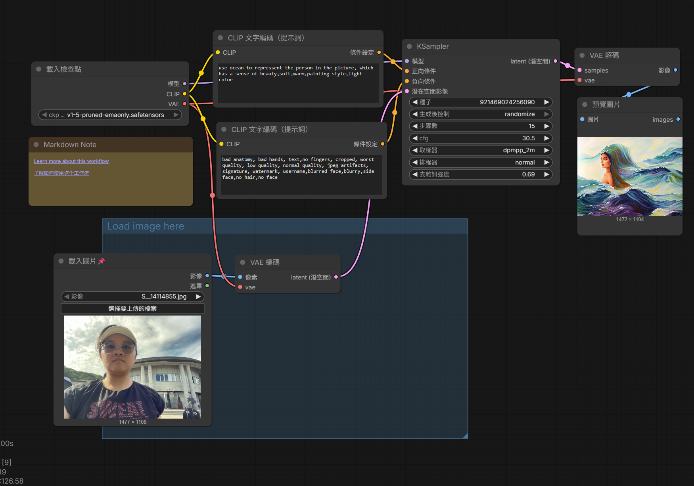

正提示詞:

use ocean to repressent the person in the picture, which has a sense of beauty,soft,warm,painting style,light color

反提示詞:

bad anatomy, bad hands, text,no fingers, cropped, worst quality, low quality, normal quality, jpeg artifacts, signature, watermark, username,blurred face,blurry,side face,no hair,no face

心得:

我發現我一開始不太會使用提示詞，沒辦法準確地運用正反提示詞，造成她每次跑出來的生成圖都怪怪的、不是我想要的圖片，最後嘗試了好幾遍之後漸漸掌握訣竅，生成了我覺得還算不錯的圖片。(不過製作過程的失敗作品能讓我笑出來我覺得也是一個不錯的體驗啦~)